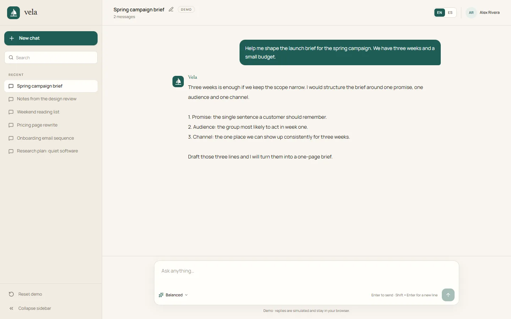

# Vela

A bilingual chat workspace for shaping ideas, summaries and plans, built as an original front-end implementation with simulated replies.



## What it is

Vela is a small, complete chat interface: a conversation sidebar, a searchable history, a message thread, a composer with a model selector, inline renaming and a reset control, in English and Spanish.

It is a demo, not a product. Replies come from a local template engine, not a model: there is no API key, no server call and no account. Everything you type stays in your browser.

## Why this over a chat template

- **Clean-room build.** The layout, copy, palette and brand were written for this project; no template classes, assets or names were carried over.
- **No fake intelligence.** The interface says it is a demo and the reply engine is readable in `src/lib/reply.ts`: it detects a summarize, brainstorm or plan intent and returns a matching template in the active language.
- **Local-first state.** Conversations, titles and the selected model persist in `localStorage` under `vela.chats.v1`; reset clears them. Nothing leaves the tab.
- **Every visible control works.** New chat, search, rename, reset, the sidebar collapse, the mobile drawer, the language switch and the composer all have behaviour. There are no decorative attach, microphone or settings buttons.
- **Bilingual by default.** `/[locale]` routes, typed dictionaries, browser-language detection, a manual switcher and `hreflang` alternates.
- **Small dependency surface.** Next.js, React, Tailwind CSS, lucide icons and one class-name helper. No UI kit, no state manager, no chat library.

## Quick start

Requirements: Node.js 24 (see `.nvmrc`) and pnpm 11.

```bash
git clone https://github.com/JORDANROBERTO74/vela-chat.git
cd vela-chat
pnpm install
pnpm dev
```

Open <http://localhost:3000>. The proxy redirects to `/en` or `/es` based on your browser's `Accept-Language` and remembers an explicit choice in a cookie.

| Command | What it does |
| --- | --- |
| `pnpm dev` | Start the development server on port 3000 |
| `pnpm build` | Create an optimized production build |
| `pnpm start` | Serve the production build |
| `pnpm lint` | Run ESLint |
| `pnpm typecheck` | Run `tsc --noEmit` |

## How the demo works

- **State.** `src/lib/chat-store.ts` owns the shape, validation and persistence. Seed conversations live in the dictionaries; runtime messages are stored per chat as `extra`, so a language switch re-renders the seed content in the new language without losing what you wrote.
- **Replies.** `buildReply` reads the message, checks English and Spanish keywords for summary, ideas or planning, and returns the matching template. Anything else gets a neutral prompt to narrow the request.
- **Timing.** The model selector only changes the simulated delay: Balanced waits 950 ms, Fast waits 350 ms. Both show a typing indicator.
- **Titles.** A new conversation takes its title from the first message, cut on a word boundary. The pencil in the top bar renames it, and the title is saved with the chat.
- **Search.** Filters titles and message text, including the localized seed conversations.

## Internationalization

Copy lives in `src/i18n/dictionaries/en.ts` and `es.ts`. The English file defines the `Dictionary` type, so a missing or misspelled key in Spanish fails `pnpm typecheck` instead of rendering a blank label.

- `src/i18n/config.ts` lists the supported locales and the default (`en`).
- `src/proxy.ts` detects the locale and redirects `/` to `/{locale}`.
- `src/lib/format.ts` centralizes `Intl` pluralization for the message count.
- Every page declares canonical and `hreflang` alternates from `src/lib/seo.ts`.

## Design

- **Palette.** Teal `#1f5c54` on linen `#f8f5ef`, with soft teal tints for selected and hover states. Tokens live in `src/app/globals.css`.
- **Type.** Newsreader for the wordmark, headings and the assistant label; Manrope for the interface. Both are self-hosted at build time through `next/font`, so the page makes no font requests to a third party.
- **Light only.** The interface declares `color-scheme: light` and has no dark variant, by design.
- **Brand.** The sail mark is drawn in `src/components/brand-mark.tsx` and reused in the favicon and Open Graph image.

## Project structure

```text
src/
  app/[locale]/          locale layout, page, not-found, Open Graph image
  components/chat/       chat app, sidebar, top bar, thread, composer, empty state
  components/layout/     locale switcher
  config/                site identity and canonical URL
  i18n/                  locale config, dictionaries and loader
  lib/                   chat store, reply engine, formatting, SEO helpers
  assets/                font instances and licenses for the Open Graph image
docs/
  screenshot.webp
```

## Accessibility and responsiveness

The thread is a live region for the typing state, the mobile drawer traps nothing but is `inert` when closed and closes with Escape, the skip link jumps to the conversation, and every icon-only control has an accessible name. The composer sends with Enter and inserts a line break with Shift + Enter. Layouts were checked at 1440 px and 390 px.

## Deployment

The app uses the default Vercel Next.js preset; no `vercel.json` is required.

1. Import the repository and keep the detected settings (`pnpm install`, `pnpm build`, output `.next`).
2. Set `NEXT_PUBLIC_SITE_URL` to the production origin.
3. Deploy, then verify `/{en,es}`, `/sitemap.xml`, `/robots.txt`, both Open Graph images and a full send, reload and reset pass.

`NEXT_PUBLIC_SITE_URL` drives canonical links, `hreflang`, `sitemap.xml`, `robots.txt` and Open Graph URLs. When it is unset, the code falls back to `https://vela-chat.vercel.app`; the public demo sets it to its Vercel origin.

Live demo: <https://vela-chat.vercel.app>

## Status and scope

This is a portfolio reference implementation, maintained but not a production chat product. There is no model, no backend, no authentication and no sync across devices. Verification covers `pnpm lint`, `pnpm typecheck`, `pnpm build` and a browser pass in both locales at desktop and mobile widths, including send, persistence after reload, rename, search, reset, the collapsed sidebar and the 404 route.

## License

Proprietary, all rights reserved. See [LICENSE](LICENSE). Third-party dependencies and the bundled font instances remain under their own licenses; see `src/assets/OFL-*.txt`.
